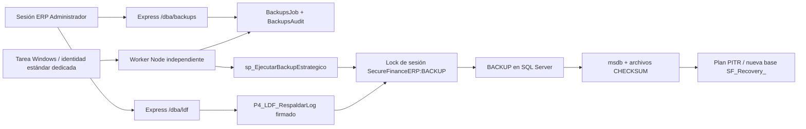

# Integración UC13 + UC14

La web Express/EJS autentica la sesión ERP y encola solicitudes UC13 mediante procedimientos parametrizados. No carga las credenciales del worker. UC14 conserva su servicio separado y sus procedimientos firmados.

## Contratos

El bloqueo común usa `SecureFinanceERP:BACKUP`, base ERP actual, principal `public`, modo `Exclusive`, propietario `Session`, espera cero. UC13 libera antes de persistir un fallo para que un error al actualizar el historial no retenga el bloqueo. La desconexión también libera el bloqueo de sesión. `UC13_WORKER` sigue siendo independiente: serializa la cola, no reemplaza la exclusión de los respaldos UC14. Se usa un pool de una conexión y se comprueba el bloqueo antes de cada operación.

`sp_BackupsRutas` devuelve únicamente la ruta UC13 registrada y la ruta UC14 habilitada cuya identidad servidor/base/GUID coincide con la instalación. El worker no recibe rutas del navegador. Solo acepta archivos inmediatos `.bak` y `.trn`, sin subdirectorios, traversal, UNC o alternate data streams. Los espacios y puntos de la ruta estándar Microsoft SQL Server son válidos; los componentes terminados en punto/espacio se rechazan. No usar junctions ni enlaces simbólicos en estas carpetas; las ACL de instalación son la frontera contra su modificación.

El catálogo lee medios DISK no segmentados de la misma familia de base. LSN se convierte en cadenas SQL y se compara con `BigInt`. El plan exige FULL no COPY_ONLY, DIFF de base LSN correspondiente y continuidad LOG; filtra corrupción, ausencia de checksum y BULK_LOGGED. Para el primer LOG posterior a una restauración, admite transición de fork únicamente si su fork final es el del FULL y el punto de bifurcación está dentro del tramo ya alcanzado. No permite saltar entre forks posteriores. Esta condición se comprobó mediante una restauración real.

Antes de planificar y de ejecutar se comparan UUID, familia, forks, tipo, nombre de base y checksum contra HEADERONLY; se ejecuta VERIFYONLY CHECKSUM y se comprueba FILELISTONLY. La identidad UUID liga el medio al registro de LSN del motor. SQL comprueba de nuevo la secuencia al restaurar. Los destinos deben comenzar por `SF_Recovery_`, no existir y conservar identidad/estado entre lotes. No se usa REPLACE, ni recuperación final incondicional, ni restauración sobre SecureFinanceERP.

## Seguridad

La cuenta web conserva únicamente consulta/solicitud UC13; no ejecuta BACKUP ni accede directamente a sus tablas. El worker tiene un login dedicado sin sysadmin ni db_owner en el ERP, lectura concreta de msdb, BACKUP DATABASE/LOG y capacidad de crear una base nueva para PITR. Esta última es una capacidad administrativa sensible y exige aislar sus secretos y ejecutables de la identidad web. No se comparte con el servicio LDF.

Se conservaron los procedimientos, certificados y tres firmas LDF. No se alteraron `P3_DDL_CapturarEstructura` ni `P3_INT_Destino()`. El ensayo usa exclusivamente `withRestoredAuthorization` del procedimiento de compatibilidad existente; restaura la propiedad de autorización en finally y deshabilita los logins SQL temporales.

## Tecnología académica

La implementación y el worker son Node.js. El documento oficial solicita C#. No existe confirmación del ingeniero que dispense ese requisito y no se declara satisfecho. Debe registrarse como discrepancia académica hasta obtener confirmación o entregar una implementación C# independiente.

Referencia de los metadatos de identidad/fork: [Microsoft: backupset](https://learn.microsoft.com/en-us/sql/relational-databases/system-tables/backupset-transact-sql).
